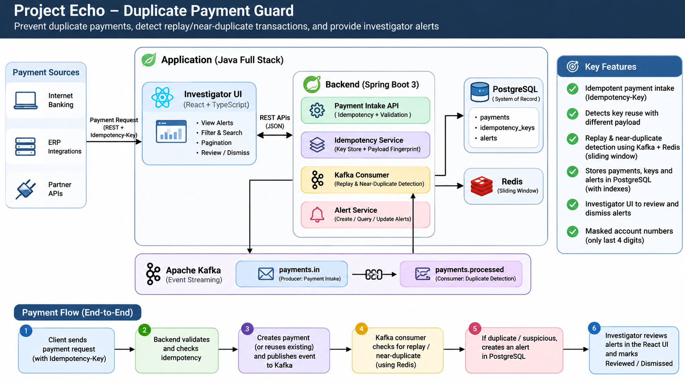

# Project Echo — Payment Guard

This repository implements the REST intake and investigator workflow, plus a partial Kafka/Redis stream path. It provides database-enforced REST idempotency, event intake through the same payment service, Redis event-time duplicate detection, paginated/masked alerts, and audited alert status changes. H2 is used for local runs; no external database application is needed.

**Scope and known gaps:** This implementation currently uses Spring Boot 4.0.9 and H2, while the assignment asks for Spring Boot 3.x and PostgreSQL. `docker compose` starts Kafka and Redis only; the backend and UI start separately. Task 2's Redis-window unit tests, Kafka/Redis integration tests, and a measured 10,000-event result are not present. Redis updates and H2 alert writes are not one transaction, so a process failure between those operations can require reconciliation. The rapid-repeat marker is per debtor/creditor pair and expires after twice the configured window, so multiple distinct bursts for the same pair within that TTL are not independently detected. These are outstanding items, not verified capabilities.

## Requirements

- Java 17 or newer
- The Maven wrapper included in this repository (`mvnw` / `mvnw.cmd`)
- Python 3 and Docker Compose are optional and only needed for Task 2 stream generation/replay
- Node.js and npm are needed to run the investigator UI and its tests

No separate H2 installation is needed; H2 is included as an application dependency. Maven's offline test command works once the wrapper and project dependencies are available in the local Maven cache.

## Architecture

```text
HTTP
  -> controller
  -> intake service / transaction
       -> idempotency_keys (database unique key)
       -> payments
       -> alerts (at most one mismatch alert per key)
  -> repositories -> H2
Kafka payments.incoming -> same intake service -> H2 event receipts
                                      -> Redis Lua sliding windows
                                      -> NEAR_DUPLICATE / RAPID_REPEAT alerts
Malformed Kafka messages -> bounded retries -> payments.incoming.DLT

GET /api/alerts -> newest-first paginated query -> DTO masks account values
PATCH /api/alerts/{id} -> atomic OPEN transition + alert_audit insert
GET /api/alerts/{id}/audit -> append-only review history
Flyway -> creates and versions the H2 database schema
```

Java classes are separated under `com.echo.paymentguard`:

| Package | Responsibility |
|---|---|
| `controller` | REST routes and HTTP response mapping |
| `service` | Payment intake, event replay handling, Redis windows, alerts and audited transitions |
| `repository` | Spring Data persistence interfaces and atomic alert transition |
| `model` | JPA entities, including append-only alert audit rows |
| `dto` | API request/response types |
| `config` | Flyway initialization and Kafka topics/retries |
| `exception` | API error handling |
| `util` | Account-number masking |

### Idempotency and transaction safety

`idempotency_keys.idempotency_key` is a primary key, so the database—not an in-memory check—serializes simultaneous attempts to reserve the same key. Payment creation and key reservation happen in one transaction. If a concurrent caller loses the unique-key race, its transaction rolls back and it looks up the winning key in a new transaction. All successful callers therefore receive the same payment ID. The mismatch alert has a unique constraint on its idempotency key, which prevents repeated or concurrent mismatches from creating multiple alerts.

The SHA-256 fingerprint is built from length-prefixed UTF-8 values for these business fields, in order: debtor account, creditor account, amount, currency, channel, reference, and `initiatedAt`. Any changed business field makes the request a mismatch. Amounts are normalized by removing insignificant trailing zeros, currency is uppercased, and `initiatedAt` is compared as an instant, so equivalent representations (for example `25.50` and `25.5000`, or different offsets for the same instant) replay consistently. Optional null fields have an unambiguous representation.

Full account values are persisted in H2 and are not included in payment responses or application-generated log messages. Alert DTOs mask every account value, showing only its last four digits (for example, `XXXXXXXX4444`). The H2 database file itself contains the persisted account values; protect that file as database data.

### Alert query indexes

Flyway creates `idx_alerts_status_created_at` over `(status, created_at DESC)` to serve status-filtered, newest-first alert listings. It also creates `idx_alerts_type_status_created_at` over `(type, status, created_at DESC)` to support requests filtering by both type and status, and `idx_alert_audit_alert_id_at` over `(alert_id, audit_at)` to read one alert's audit history in order.

## H2 database

The default connection is configured in `src/main/resources/application.properties`:

```properties
spring.datasource.url=jdbc:h2:file:./echo-payment-guard;DB_CLOSE_ON_EXIT=FALSE
spring.datasource.username=sa
spring.datasource.password=
spring.jpa.hibernate.ddl-auto=validate
```

The application uses H2 directly with no PostgreSQL compatibility or external-database settings. The database is created in the repository's working directory as `echo-payment-guard.mv.db` when the service first starts. Flyway applies migrations V1–V4 for payments, idempotency keys, alerts, alert audit, processed stream events, and indexes. Hibernate validates the migrated schema instead of generating or modifying it. H2 files are excluded from Git. This is a local-development/test choice and does not satisfy the assignment's PostgreSQL 15+ requirement.

The database is persistent across service restarts. To start over, stop the service and remove the specific `echo-payment-guard.mv.db` file from the directory in which the service was launched; the next start recreates the schema. Do not remove the file while the service is running.

The H2 connection is configured in `src/main/resources/application.properties`. No `.env` file or database credentials need to be configured; `.env.example` lists the optional stream environment variables.

## Run the application

From the repository root:

```powershell
.\mvnw.cmd spring-boot:run
```

On macOS/Linux:

```sh
./mvnw spring-boot:run
```

The API listens at `http://localhost:8080`. The H2 web console is not enabled. Keep the service running in this terminal while trying the examples in another terminal. Use only synthetic data.

## REST API

### `POST /api/payments`

Required header: `Idempotency-Key` (nonblank; maximum 512 characters).

Required JSON fields: `debtorAccount`, `creditorAccount`, `amount`, `currency`, and `initiatedAt`. `channel` and `reference` are optional. Amount must be positive, currency must contain exactly three letters, and accounts must not be blank.

The three idempotency outcomes can be tried in order using the following examples. The first two use the same key and payload; the third changes the amount but retains the key.

**1. First request — `201 Created`:**

```sh
curl.exe -i http://localhost:8080/api/payments `
  -H "Content-Type: application/json" `
  -H "Idempotency-Key: demo-payment-001" `
  -d '{"debtorAccount":"1111222233334444","creditorAccount":"5555666677778888","amount":25.50,"currency":"USD","channel":"WEB","reference":"SYNTHETIC-REF-01","initiatedAt":"2026-11-14T06:30:00Z"}'
```

On macOS/Linux, replace `curl.exe` and PowerShell backticks with `curl` and shell line continuations (`\`). Response body:

```json
{"paymentId":"<generated-uuid>","status":"ACCEPTED"}
```

**2. Same key and same payload — `200 OK`:**

Repeat the exact request above. It returns the same `paymentId`, adds `Idempotent-Replayed: true`, and does not create another payment.

**3. Same key and different payload — `409 Conflict`:**

```sh
curl.exe -i http://localhost:8080/api/payments `
  -H "Content-Type: application/json" `
  -H "Idempotency-Key: demo-payment-001" `
  -d '{"debtorAccount":"1111222233334444","creditorAccount":"5555666677778888","amount":26.50,"currency":"USD","channel":"WEB","reference":"SYNTHETIC-REF-01","initiatedAt":"2026-11-14T06:30:00Z"}'
```

The response is a clear error body and one `KEY_REUSE_MISMATCH` alert is recorded. Repeating this changed request returns `409` without creating another alert.

Missing/blank keys and invalid JSON/body fields return `400` with an `error` message. For example, try removing the key header, or change `"amount":26.50` to `"amount":0`.

### `GET /api/alerts`

Optional query parameters: `type`, `status`, `page` (zero-based, default `0`), and `size` (default `20`, maximum `100`). Results are newest first; the response includes `content`, `page`, `size`, and `totalElements`.

```sh
curl.exe "http://localhost:8080/api/alerts?type=KEY_REUSE_MISMATCH&status=OPEN&page=0&size=20"
```

The alert response contains alert metadata and masked accounts, never the full debtor or creditor account values.

### Investigator actions

Only an `OPEN` alert can be changed to `REVIEWED` or `DISMISSED`. Any other transition returns `409 Conflict` and does not add an audit record. The status update is conditional in the database, so simultaneous actions cannot both succeed. A successful transition and its audit row are committed in the same transaction.

```powershell
curl.exe -i -X PATCH http://localhost:8080/api/alerts/<alert-id> `
  -H "Content-Type: application/json" `
  -H "X-User: investigator-01" `
  -d '{"status":"REVIEWED","note":"Validated with the vendor"}'

curl.exe http://localhost:8080/api/alerts/<alert-id>/audit
```

The audit history records `alertId`, `fromStatus`, `toStatus`, `actor`, `note`, and `at`. `X-User` supplies the actor; if omitted, the API records `investigator`. Audit rows are exposed only as a read endpoint and are never modified by status changes.

## Investigator UI

The React + TypeScript UI in `frontend/` provides type/status filters, server-side pagination, masked debtor/creditor accounts, amount/currency and creation time, and actions for open alerts. Actions send `PATCH /api/alerts/{id}` with `status`, `note`, and `X-User: investigator`; successful status changes update the displayed row without reloading the page. Errors from the API are shown in the UI.

Start the backend from the repository root:

```powershell
.\mvnw.cmd spring-boot:run
```

In another terminal, start the UI:

```powershell
cd frontend
npm install
npm run dev
```

Open the Vite URL (normally `http://localhost:5173`). Vite proxies `/api` requests to `http://localhost:8080`. Create an alert using the changed-payload example above, then refresh the queue to view it and test Mark reviewed or Dismiss.

Run the frontend test and production build from `frontend/`:

```powershell
npm test
npm run build
```

The React Testing Library tests render a mocked alert response, verify that
Dismiss sends `PATCH /api/alerts/{id}` with `status: "DISMISSED"`, and check
that a failed action displays an error. For a manual UI check, run the backend
and frontend using the commands above, create an alert with the changed-payload
example, and verify:

- Type and status filters and Previous / Next pagination update the displayed
  alerts.
- Alert rows show masked accounts, amount with currency, and created time.
- Mark reviewed and Dismiss send a note and `X-User` header; on success the
  row status changes without a full-page reload.
- `GET /api/alerts/<alert-id>/audit` shows the successful status change.

The backend tests cover allowed and rejected status transitions and their audit records. Run them with `.\mvnw.cmd -o test` from the repository root.

## Kafka and Redis stream processing

The stream path is disabled by default so the REST application and offline tests do not require live Kafka or Redis. `docker compose` starts only the broker services; the backend must be started separately. To enable the stream locally:

```powershell
docker compose up -d kafka redis
```

In the terminal used to start the backend, enable the stream listener:

```powershell
$env:PAYMENT_KAFKA_ENABLED = "true"
.\mvnw.cmd spring-boot:run
```

The default endpoints are Kafka `localhost:9092` and Redis `localhost:6379`; override them with `KAFKA_BOOTSTRAP_SERVERS`, `REDIS_HOST`, and `REDIS_PORT`. Window settings are externalized in `src/main/resources/application.yml`:

| Setting | Default | Meaning |
|---|---:|---|
| `PAYMENT_WINDOW` | `10m` | Sliding event-time window measured from `initiatedAt` |
| `PAYMENT_RAPID_REPEAT_THRESHOLD` | `5` | Pair count that triggers one rapid-repeat alert |
| `PAYMENT_EVENT_ID_RETENTION` | `90d` | Retention for processed event receipts |
| `PAYMENT_KAFKA_RETRY_DELAY` | `1s` | Delay between malformed/failed message retries |

Events are JSON objects with `eventId` plus the same payment fields as the REST request. They pass through `IntakeService`; the stream path does not implement a separate payment creation flow. A processed event receipt is stored in H2's `processed_payment_events` table and retained for 90 days. The cleanup job removes completed receipts past retention. Its `stream:<eventId>` idempotency key remains in `idempotency_keys` without expiry, so a very late redelivery still cannot create a second payment after the event receipt is removed. Processed receipts include a processing state so an interrupted event can retry its alert-window work. Redis window updates and H2 alert writes are separate operations rather than a distributed transaction; failures between them are not covered by automated reconciliation.

Redis stores sorted sets keyed by debtor/creditor pair and exact payment fingerprint. A single Lua script updates both sets, trims event-time scores, finds the nearest exact match inside the event-time window (preferring the latest earlier timestamp, while still detecting an out-of-order event), counts pair events, and claims the rapid-burst marker atomically. Keys receive a TTL on updates; the marker uses `SET NX` with expiry. `NEAR_DUPLICATE` includes the new and matching payment IDs. `RAPID_REPEAT` fires when a pair reaches the configured threshold regardless of amount. Bad JSON or invalid events are retried twice after the initial attempt and then published to `payments.incoming.DLT`. The current marker's TTL behavior is why this is a partial implementation for workloads with multiple bursts in quick succession.

### Generate, replay, and check a synthetic stream

Python 3 is only needed for the utility scripts. The generator produces at least 10,000 unique synthetic events, repeats one `eventId`, seeds an exact near-duplicate pair, creates a seven-payment rapid burst with distinct amounts, writes malformed lines, and writes an alert manifest:

```powershell
python scripts/generate_stream.py --count 10000
```

With Docker Compose Kafka/Redis and the backend running with `PAYMENT_KAFKA_ENABLED=true`, publish the generated file and wait for every unique event in the run to complete:

```powershell
python scripts/replay_stream.py
```

The replay command prints unique events completed, elapsed end-to-end time, and measured events/second (completed event count divided by wall-clock time from producer start to final completion). The stream-status endpoint is used only for this measurement.

Compare alerts to the generated manifest:

```powershell
python scripts/check_alerts.py
```

The checker prints expected and detected counts per seeded alert type plus unexpected and missing counts. Run against a clean H2 database: the checker compares all detected stream alerts against the current manifest, so prior stream runs can be reported as unexpected. A successful run should detect the manifest's `NEAR_DUPLICATE` and `RAPID_REPEAT` alerts with no unexpected alerts. No benchmark was run while implementing these changes; do not treat an unmeasured throughput as a result.

## Tests

Run the complete test suite without Docker or external services:

```powershell
.\mvnw.cmd -o test
```

On macOS/Linux:

```sh
./mvnw -o test
```

`-o` forces Maven offline mode. If Maven has never downloaded the wrapper distribution or dependencies on this machine, run `.\mvnw.cmd test` once with network access, then use the offline command. Tests use an isolated in-memory H2 database in native H2 mode; they do not read/write the local file-backed application database.

`PaymentIntakeTests` verifies the Task 1 H2 path:

- First request returns `201` and one accepted payment.
- Same-key, same-payload replay returns `200`, the original ID, `Idempotent-Replayed: true`, and no second payment.
- Same-key, different-payload request returns `409` and creates exactly one `KEY_REUSE_MISMATCH` alert.
- Missing idempotency key and invalid amount return `400`.
- Payment and alert API responses do not expose full synthetic account values; alert results contain masked values.
- At least 20 concurrent requests with the same key create exactly one payment and all return the same ID.
- Flyway creates the payment, idempotency, alert, audit, and processed-event tables and indexes.
- Valid alert status transitions write an audit row; rejected transitions return `409` without writing one.
- Stream-window unit and Kafka/Redis integration tests are not included yet.

Run the React UI tests from `frontend/`:

```powershell
cd frontend
npm test
```

Kafka and Redis are optional services; the plain Maven test run is designed to work offline without them. The 10k stream replay requires Docker Compose and live Kafka/Redis. Frontend dependencies must be installed before running `npm test`.

## Remaining work

Outstanding assignment items include PostgreSQL 15+ with PostgreSQL migrations, Spring Boot 3.x compatibility, a one-command full-stack Compose setup, Task 2 unit and live-service tests, reliable detection of separate rapid-repeat bursts, and a recorded 10,000-event run with measured throughput and zero unexpected alerts.
